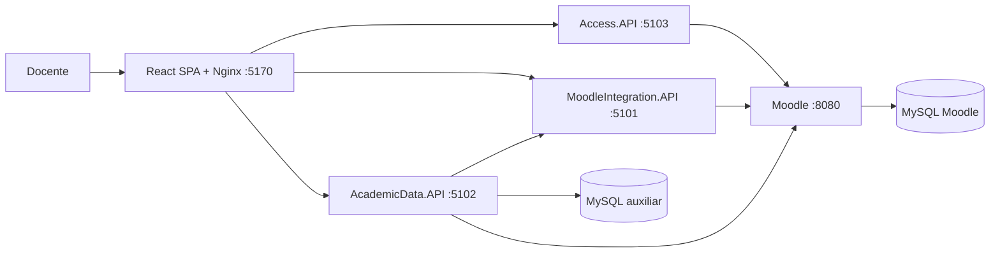

# EduMonitorAI

Sistema académico integrado con Moodle, desarrollado con React, ASP.NET Core .NET 10 y MySQL 8.4. Este incremento implementa la base del Sprint 1 (HU-01 a HU-05): laboratorio con datos ficticios, microservicios, identidad Moodle, autorización por curso, importación auxiliar sin duplicados y consulta docente de cursos, calificaciones y actividades.

## Inicio rápido

1. Instalar Docker Desktop/Engine con contenedores Linux y Compose v2.
2. Copiar `infra/.env.example` a `infra/.env` y completar las cinco contraseñas. La contraseña Moodle debe cumplir su política de complejidad.
3. Ejecutar:

```powershell
docker compose up --build -d --wait --wait-timeout 600
docker compose logs -f moodle
```

Esperar `Laboratorio preparado`; acceder a [Moodle](http://localhost:8080) y a la [vista docente de EduMonitorAI](http://localhost:5170). Usuarios ficticios: `docente`, `otrodocente`, `estudiante01` a `estudiante12`, con `MOODLE_LAB_PASSWORD`; administrador `admin` con `MOODLE_ADMIN_PASSWORD`.

La [guía del Sprint 1](docs/requirements/sprint1.md) explica configuración, obtención del token personal, endpoints y sincronización, datos de prueba, seguridad y limitaciones. La base elegida es **MySQL**, conforme a la solicitud de implementación, sustituyendo la propuesta PostgreSQL del sprint.

## Arquitectura



Access valida identidad y permisos; MoodleIntegration recupera cursos, estudiantes, actividades y calificaciones; AcademicData conserva una copia transaccional. React Router representa las vistas en URLs del navegador y conserva Atrás/Adelante. Nginx sirve el bundle y actúa como proxy de mismo origen hacia las APIs. Todas las rutas académicas comprueban el token y el acceso efectivo por curso. Moodle sigue siendo la fuente oficial. Las APIs no escriben calificaciones en Moodle.

Cada host expone `/health`; OpenAPI solo en Development. Las bases no publican puertos. Los puertos HTTP de laboratorio se enlazan a loopback; un despliegue real requiere HTTPS.

## Pruebas

Con SDK .NET 10:

```powershell
dotnet test backend/EduMonitorAI.sln -c Release
```

Con el laboratorio iniciado y PowerShell 7:

```powershell
./scripts/acceptance-sprint1.ps1 -LabPassword (Read-Host 'Contraseña de laboratorio' -AsSecureString)
```

La suite contiene 30 pruebas .NET. La [matriz de comprobación](docs/evidence/matriz-comprobacion.md) registra la aceptación ejecutada con Docker, Moodle y MySQL.

## Alcance restante

La vista del Sprint 1 cubre cursos autorizados, sincronización manual, participantes, calificaciones individuales y estructura de actividades. El dashboard estadístico, las alertas, recomendaciones y Ollama corresponden al Sprint 2; conversación y reportes al Sprint 3. No se infieren estados de entrega desde una nota ausente. Las respuestas completas por curso están dimensionadas para el laboratorio; cursos grandes requieren paginación.

Ver [arquitectura](docs/architecture/README.md), [decisión de identidad y MySQL](docs/architecture/decisions/0002-sprint1-mysql-identidad.md), [decisión de frontend React y navegación](docs/architecture/decisions/0003-frontend-react-historial.md), [contratos API](docs/api/README.md) y [pautas de contribución](CONTRIBUTING.md).

## Acceso mediante correo

El formulario Moodle permite correo y contraseña (también conserva el usuario Moodle). Cuentas ficticias disponibles en [Moodle](http://localhost:8080/login/index.php):

| Perfil | Correo | Contraseña inicial |
|---|---|---|
| Docente | docente@example.invalid | `Docente123!` |
| Estudiante | estudiante01@example.invalid | `Estudiante123!` |

El docente accede a PROGRAMACION y BASES-DATOS. El estudiante entra a Moodle y a sus actividades; las APIs de análisis siguen restringidas a docentes. Los correos `.invalid` son ficticios y no reciben mensajes.

Estas dos cuentas usan `MOODLE_TEACHER_PASSWORD` y `MOODLE_STUDENT_PASSWORD`, con los valores anteriores como predeterminados locales. La semilla aplica sus contraseñas configuradas en cada arranque. Los demás usuarios conservan `MOODLE_LAB_PASSWORD`; admin conserva `MOODLE_ADMIN_PASSWORD`. Para personalizarlas, añadir las variables a `infra/.env` y recrear Moodle.

Verificar el formulario (dos accesos válidos y contraseña incorrecta rechazada): `./scripts/verify-email-login.ps1`. Si se personalizan las contraseñas, pasar `-TeacherPassword` y `-StudentPassword` como SecureString; el script de aceptación admite los mismos parámetros junto con `-LabPassword`.
