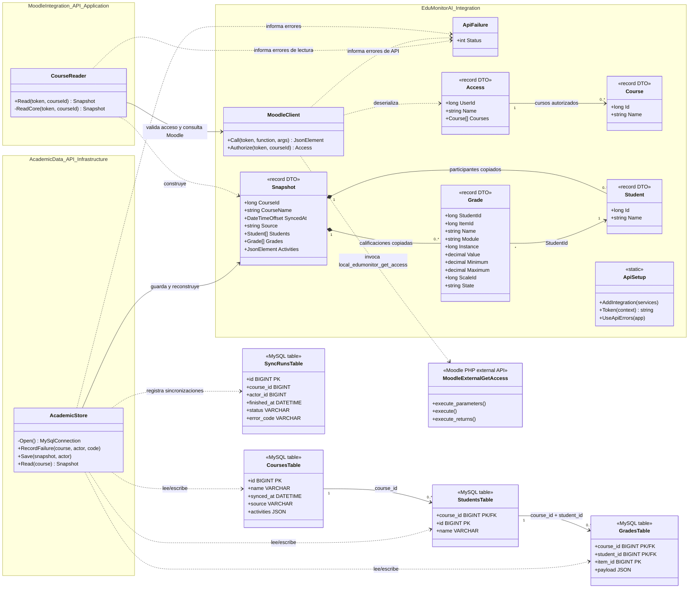

# Diagrama de clases — Sprint N1

El diagrama refleja las clases y contratos implementados en el repositorio para el alcance de Sprint N1: autorización de cursos, consulta a Moodle, sincronización de datos académicos y lectura de la copia auxiliar. Los tipos `Course`, `Student`, `Grade`, `Snapshot` y `Access` son `record` de C# usados como DTO; no son entidades de dominio con identidad propia.

## Responsabilidades y límites

- `Access.API`, `MoodleIntegration.API` y `AcademicData.API` se componen en sus respectivos `Program.cs` con minimal APIs; no hay clases de controlador ni entidades ORM en este incremento.
- `MoodleClient` es el adaptador HTTP compartido. `CourseReader` obtiene participantes, actividades y notas de Moodle y forma el `Snapshot`. `AcademicStore` valida y persiste/reconstruye ese snapshot en MySQL dentro de transacciones.
- Las tablas del diagrama son el esquema físico definido en `infra/mysql/001-schema.sql`, no clases C# generadas. Las actividades se conservan como JSON en el snapshot/columna `courses.activities`; las notas conservan su payload JSON en `grades.payload`.
- El complemento Moodle implementa `local_edumonitor\\external\\get_access`; filtra cursos con capacidades de lectura de notas y participantes antes de devolver `Access` al backend.
- El frontend React está construido con funciones (`App`, `LoginPage`, `DashboardLayout`, `CoursePage`, `Roster`, `StudentGrades`, `CourseContent` y otras), no con clases. Por eso no forma parte del UML de clases. El frontend consume las APIs y muestra contratos serializados; no contiene entidades de dominio propias.
- El agente IA y sus clases no aparecen porque no están implementados en Sprint N1.

## Fuentes del diagrama

- `backend/src/BuildingBlocks/Integration/MoodleClient.cs`
- `backend/src/Services/MoodleIntegration.API/CourseReader.cs`
- `backend/src/Services/AcademicData.API/AcademicStore.cs`
- `backend/src/Services/{Access.API,MoodleIntegration.API,AcademicData.API}/Program.cs`
- `infra/mysql/001-schema.sql`
- `infra/moodle/local/edumonitor/classes/external/get_access.php`
